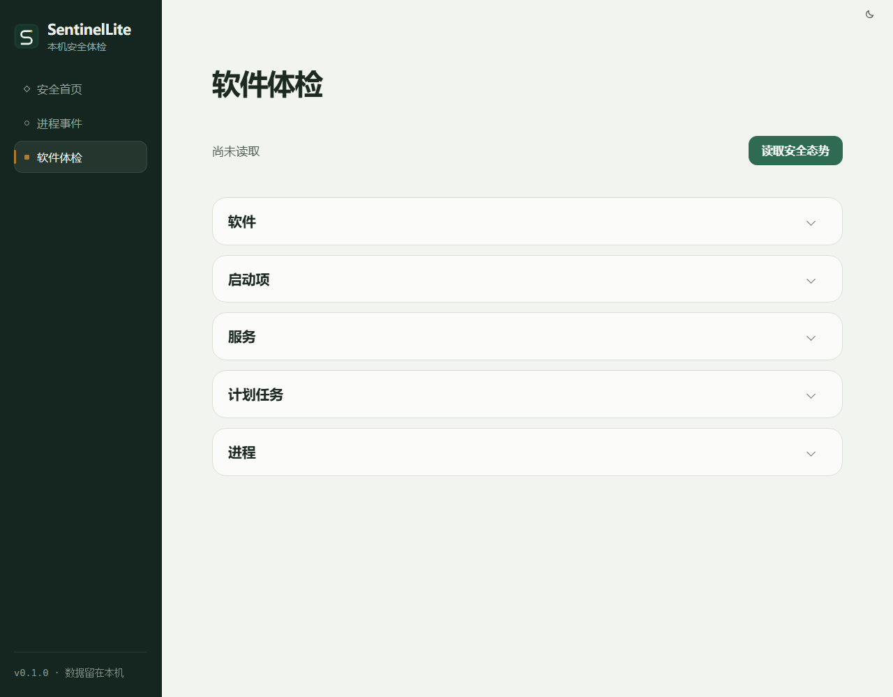
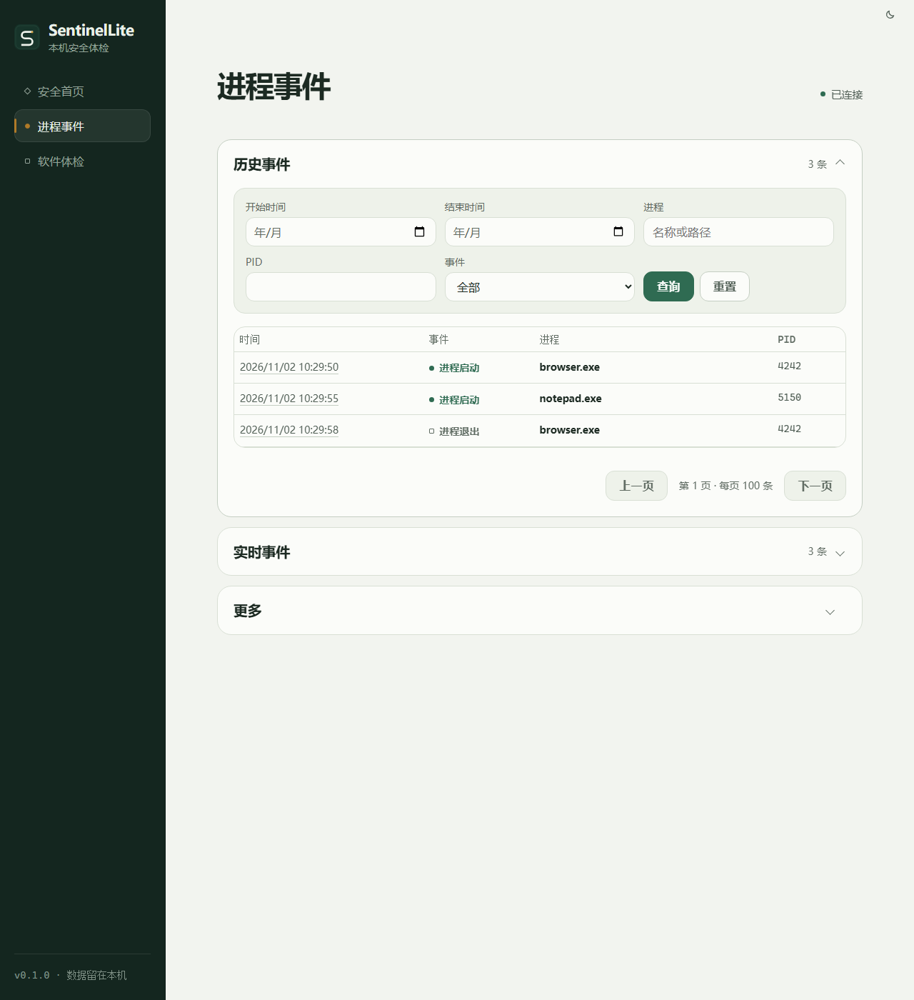
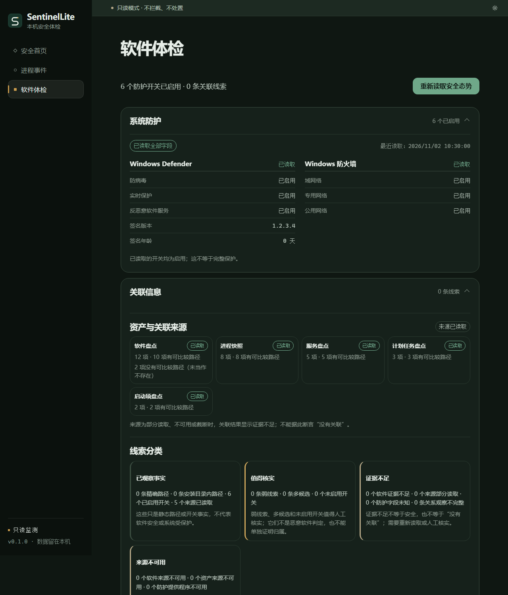
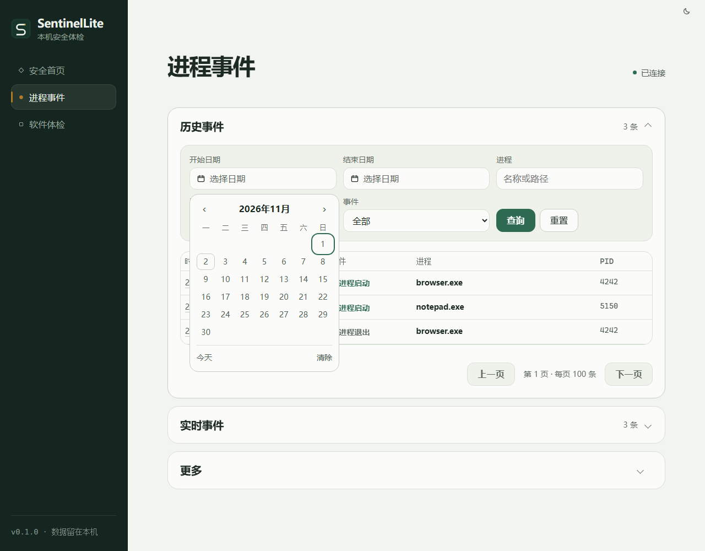

# SentinelLite

**A local-first, read-only Windows security inspection tool.** SentinelLite shows what it can observe, what it cannot, and why. It does not present a false "all clear" and it does not change your system.

> **Status: 0.1.0 early preview — source-only release candidate; publication pending.** This repository contains source code only. It does **not** provide a Windows installer, a prebuilt `sentinel-lite.exe`, a `SentinelLiteSensor.exe`, or any other executable build output. Build from source using the instructions below. See [RELEASE_NOTES.md](RELEASE_NOTES.md) and [SOURCE_ONLY_LICENSE_NOTICE.md](SOURCE_ONLY_LICENSE_NOTICE.md).
>
> SentinelLite is not an antivirus and is not a replacement for Windows Defender. It does not remove malware, block processes, uninstall software, or modify Windows security settings. Read [Known limitations](docs/KNOWN_LIMITATIONS.md) before relying on any result.

## Screenshots

The screenshots below use the current UI. Previews that contain sample rows use synthetic data, not data from a real machine. Other images under `docs/screenshots/` are historical read-only validation captures, not synthetic previews; see [docs/screenshots/README.md](docs/screenshots/README.md) for provenance.



*Software checkup preview (empty state). In-app sensor enabling is unavailable in 0.1.0.*



*Process event history. Rows and timestamps are sample data.*



*Synthetic posture preview with sample counts. This is not a security score.*



*Date filters for local event history, shown with sample rows.*

## What works in 0.1.0

All scans are started explicitly by the user. Results are kept in memory unless a feature says otherwise. The main application runs as a standard user.

| Area | What it does now |
| --- | --- |
| Installed software inventory | Reads the traditional Uninstall registry views (HKLM 32/64-bit and one shared HKCU view). Shows version, publisher, install location status, DisplayIcon path clue, uninstall-entry presence, classification fields, and per-source/per-item observation status. It never returns or executes uninstall command text. |
| Startup inventory | Reads Run/RunOnce and per-user/all-user startup folders. Preserves registry value types and source/item status. Resolves `.lnk` targets read-only; arguments and working directory are recorded only as present/absent. |
| Services and scheduled tasks | Read-only snapshots from SCM and Task Scheduler. Shows status, start type, account, and executable paths. Parameters, task arguments, working directories, triggers, and schedules are not read. |
| Process snapshot | Lists visible user-mode processes with PID, parent PID, readable image path, and a creation-time identity token. Supports a bounded affinity, signature, file metadata, SHA-256, and short CPU sample inspection for a selected process. |
| Native protection snapshot | User-triggered read-only query of Windows Defender switches/signature and the three Windows Firewall profiles. Missing fields, access denial, and provider failures remain visible as partial or unknown. |
| Process telemetry (optional sensor) | A separate administrator process, `SentinelLiteSensor.exe`, consumes Kernel-Process ETW start/stop events, normalizes and pairs them, and exposes read-only status/event batches over a restricted named pipe. The main app can store events in a local SQLite database and show live/history/analysis pages. |
| Asset associations and posture | Compares static paths from software, processes, services, scheduled tasks, and startup items. Exact, contained, and weak clues are labeled separately. The posture view combines existing read-only snapshots without producing a score or a "protected" verdict. |
| UI | Light and dark themes, expandable sections, explicit partial/unknown states, pagination, and date-range filters. |

The optional sensor currently covers process start/stop only. It does not monitor files, network connections, DLL loads, services, scheduled tasks, or registry changes continuously.

## What SentinelLite does not do

- It does not detect or remove malware with a signature/behavior engine. It has no malware sample validation and no false-positive/false-negative rate.
- It does not block, suspend, terminate, quarantine, uninstall, delete, or disable anything.
- It does not modify Defender, firewall, services, scheduled tasks, startup items, registry values, or process affinity.
- It does not produce a 0-100 security score or an overall "protected" state. The overall protection state remains **unknown**.
- It does not support AppX/MSIX/Store apps, portable apps, browser extensions, or uninstall leftovers.
- It does not provide an in-app sensor start or any UAC/privilege-elevation action.
- It does not upload data, send telemetry, check for updates, or make network requests.
- It is not a hardened anti-rootkit or EDR product. It does not defend against an attacker who already has administrator or kernel access.

## Safety and privacy design

- **Read-only by default.** Scans use read-only Windows APIs. There are no remediation buttons.
- **Fixed command surface.** The WebView can call 16 fixed application commands through a Tauri application-level ACL. `core:default` is not granted, and no Shell, filesystem, or HTTP plugin is exposed.
- **No in-app elevation.** The main app runs as a standard user and exposes no in-app sensor start, UAC, `runas`, or ShellExecute path. The optional `SentinelLiteSensor.exe` must be started manually by an administrator outside the app; it only exposes read-only status and event batches over a restricted local named pipe.
- **No automatic startup.** 0.1.0 has no background service, no auto-start, no auto-update, and no in-app elevation action.
- **Bounded input.** Registry views, item counts, strings, process snapshots, association results, event batches, and query sizes have hard limits. Truncation and partial reads are shown explicitly; they are not treated as "clean".
- **Presentation-boundary redaction.** Service accounts, task identities, task names, software paths, startup targets, and association evidence are redacted before being returned to the WebView. User-profile segments are replaced with `***`. The scanners still use raw paths internally for matching.
- **Process-path caveat.** The process view shows executable paths as evidence and may display a local path containing a user-profile name. See [PRIVACY.md](PRIVACY.md).
- **Local storage only.** Process event history is stored in a local SQLite database under the current user's local application data directory. The database is not encrypted and is protected by the current user's Windows ACL. It is not a tamper-proof audit log.
- **Unknown is not safe.** Access denied, missing fields, truncated results, unavailable providers, and disconnected sensors stay visible as unknown/partial. They are never converted into a green "protected" result.

## System requirements

- Windows 10 or Windows 11, x64. The current release is validated on Windows 11 Pro 10.0.26200 x64.
- Microsoft Edge WebView2 Runtime. Windows 11 normally includes it; Windows 10 may need the runtime installed.
- The main application does not require administrator rights.
- The optional `SentinelLiteSensor.exe` requires administrator rights to create the ETW real-time session.

To build from source you also need:

- Node.js 22.13 or newer and npm.
- Rust stable with the MSVC target (`rustup default stable-x86_64-pc-windows-msvc`).
- Visual Studio 2022 Build Tools with the "Desktop development with C++" workload, MSVC v143, and a Windows 10/11 SDK.

## Build and run

```powershell
npm ci
npm run build
npx tauri build --no-bundle
```

The application executable is written under the Cargo workspace target directory (`target\release\sentinel-lite.exe` in this repository).

To build the optional sensor:

```powershell
cargo build --release -p sentinel-sensor
```

This produces `target\release\SentinelLiteSensor.exe`. A locally built 0.1.0 installer does **not** bundle the sensor, and the public source-only release does not distribute the installer or sensor. Start the sensor manually as an administrator outside the application; 0.1.0 does not provide an in-app Enable action or UAC launch path.

For development:

```powershell
npm ci
npx tauri dev
```

An unsigned NSIS installer can be produced locally with:

```powershell
npx tauri build
```

For a binary build from source, use the wrapper that remaps the build user's profile path out of panic metadata:

```powershell
powershell -ExecutionPolicy Bypass -File scripts\build-release.ps1
```

These commands are build instructions, not a promise that the public release provides binaries. Locally built unsigned binaries may trigger Microsoft SmartScreen. No code-signing certificate or automatic updater is currently provided.

`SHA256SUMS.txt` is computed over the LF-normalized Git source blobs. Because `.gitattributes` requests `eol=lf`, use a clean clone with `git -c core.autocrlf=false clone ...` or the GitHub source archive when verifying checksums; a Windows working tree may show CRLF line endings.

## Tests and checks

```powershell
npm run typecheck
npm run lint
npm test -- --run
npm run build
npm audit --audit-level=high

cargo fmt --all -- --check
cargo clippy --workspace --all-targets --all-features -- -D warnings
cargo test --workspace
```

The real-host read-only smoke test is ignored by default because its result depends on the machine:

```powershell
cargo test -p sentinel-core --test readonly_host_smoke -- --ignored --nocapture
```

The current automated suite has 350 Rust tests passing (1 ignored) and 191 frontend tests passing. Test counts are recorded in [docs/VALIDATION.md](docs/VALIDATION.md).

## Project layout

```text
crates/sentinel-core/       Read-only scanners, rules, evidence model, Windows APIs
crates/sentinel-events/     Shared normalized process-event model
crates/sentinel-ipc/        Read-only status/event protocol and named-pipe client/server
crates/sentinel-sensor/     Separate ETW process sensor and bounded delivery
crates/sentinel-storage/    Local SQLite persistence and retention
crates/sentinel-detection/  Explainable process-behavior rules and data-quality gates
src-tauri/                  Tauri command layer, ACL, capabilities, desktop entry
src/                        React/TypeScript UI and tests
docs/                       Architecture, threat model, validation, limitations, ADRs
```

## Known limitations

See [docs/KNOWN_LIMITATIONS.md](docs/KNOWN_LIMITATIONS.md) for the full list. The most important ones are:

- 0.1.0 provides no in-app sensor start/stop or UAC elevation path. The source-only public release does not include the sensor; a locally built installer also does not bundle it. An administrator must build and start the sensor manually outside the application.
- The overall protection state is unknown; there is no complete health model and no "protected" state.
- The database is not encrypted and is not tamper-proof.
- The application tree has exceeded the 100 MB memory target in a measured idle sample; the sensor and WebView2 processes are included in that measurement.
- Windows 10, ARM64, enterprise policy environments, and multi-DPI automation are not fully validated.
- No third-party security audit, penetration test, fuzzing campaign, or malware-sample evaluation has been completed.
- The source-only release does not publish an installer or prebuilt binaries. The source SBOM is under `third-party-sbom/`; the binary SBOM is retained only as a historical build record. There is no signed or reproducible binary release chain.

## Privacy

SentinelLite does not upload data or include telemetry. It reads local metadata only when the user triggers a scan. The full data inventory, storage locations, redaction rules, and deletion guidance are in [PRIVACY.md](PRIVACY.md).

## Security reports

Do not open a public issue containing exploit details, real user data, credentials, or personal information. See [SECURITY.md](SECURITY.md) for the private reporting channel and scope.

## Contributing and changelog

Contribution rules are in [CONTRIBUTING.md](CONTRIBUTING.md). The source-only release notes are in [RELEASE_NOTES.md](RELEASE_NOTES.md); the 0.1.0 feature/limitation record is in [CHANGELOG.md](CHANGELOG.md).

## License

[MIT](LICENSE). Third-party dependency licenses, the per-package bundle, MPL source materials, and CycloneDX SBOMs are in [docs/THIRD_PARTY.md](docs/THIRD_PARTY.md), [THIRD_PARTY_NOTICES.md](THIRD_PARTY_NOTICES.md), [third-party-licenses/](third-party-licenses/), [third-party-source/mpl/](third-party-source/mpl/), and [third-party-sbom/](third-party-sbom/).

## 中文摘要

SentinelLite 是一个本地优先、只读的 Windows 安全体检工具。它展示能观察到的证据以及无法确认的部分，不把未知显示成安全，也不执行卸载、拦截、清除或系统设置修改。

当前版本可以只读盘点软件、启动项、服务、计划任务、进程、Defender/防火墙状态，并提供静态路径关联和只读安全态势概览；可选的独立管理员传感器负责进程 start/stop 事件、本地 SQLite 历史和基础行为线索。主应用以普通用户运行；0.1.0 不提供应用内启动或 UAC 提权入口，传感器需管理员在应用外手动启动。

重要限制：0.1.0 不是杀毒软件，不提供恶意软件判定、处置或整体“保护正常”结论；本次是 source-only 发布，不提供安装包、预编译应用或传感器二进制，本地构建的安装包也不包含传感器；应用内不提供启动/停止或 UAC 提权入口；本地构建的可执行文件未签名；整体保护状态保持未知。完整限制见 [docs/KNOWN_LIMITATIONS.md](docs/KNOWN_LIMITATIONS.md)。
